# NZB-CC: a home media command center, with HAL 9000 in charge

> "Good evening, Dave. Everything's running smoothly."

NZB-CC runs on a Windows PC at home and pulls the house's downloads, media, PC and network into one place. You use it
from three screens: **HAL 9000** on your phone, **the TV**, and the original **desktop command centers** on the PC.
Find something, put it on the TV, turn it up, pause the ads, check the drives, restart a service, lock the PC: all
from the couch, by tap or by voice ("Hey Siri, ask HAL, play Glass Meridian").

**New: stream straight from Usenet, with no download at all.** Downloading is now optional. Every search result
on the phone has two buttons: **+ Add** downloads it the usual way, into your library, and **▶ Stream** plays it on
the TV straight from Usenet, usually within a minute. Nothing is downloaded and no disk space is used, which is pretty cool.
Like what you're watching? One more tap downloads a copy to keep. And HAL always knows which is which: a blue
**USENET** label for streams, a grey **ON YOUR PC** label for your own movies, and *"You're watching Glass Meridian,
streaming from Usenet."*

<p align="center">
  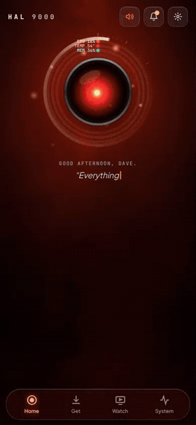
  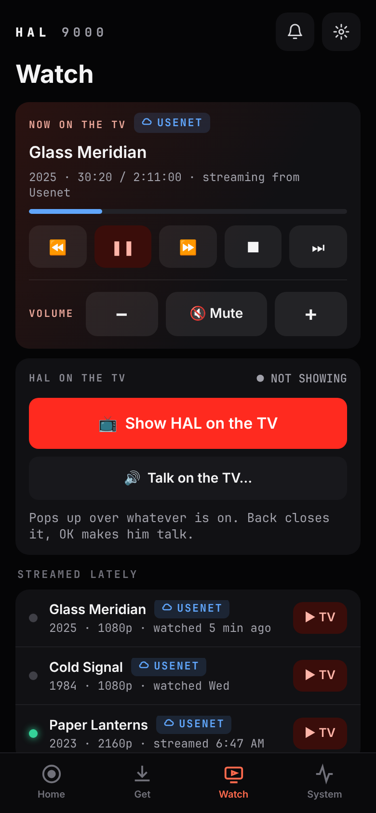
</p>
<p align="center">
  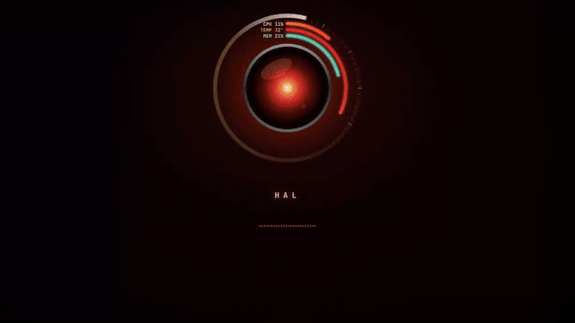
</p>
<p align="center">
  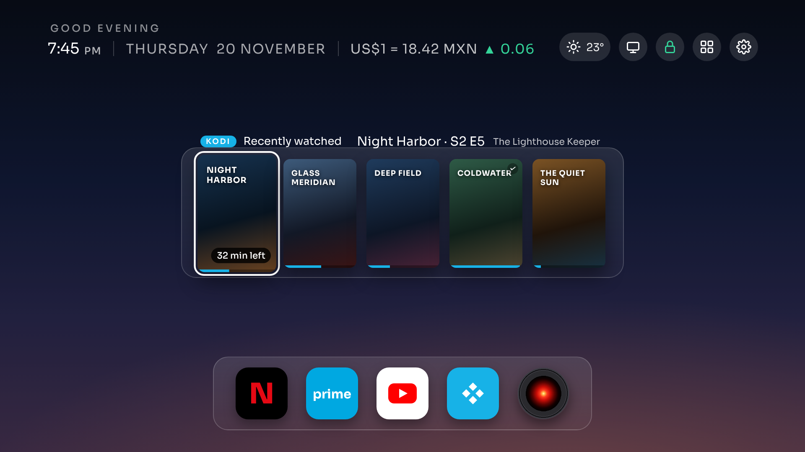
</p>
<p align="center"><em>HAL 9000 on the phone, a movie streaming to the TV straight from Usenet, HAL's screen on the TV, and the TV's custom home screen</em></p>

**The TV runs an interface of our own.** We replaced the Sony's stock home screen, with its ads and promos, with
our own build of the open-source CleanYourTV launcher, then built on it:
- a clean one-line header with the time, the weather and the dollar-to-peso rate;
- Kodi's recently watched shelf, which resumes with one press of OK;
- "Ready to watch" cards when a download finishes;
- a glass dock with just the apps we use;
- **HAL 9000's own screen**: his eye, his voice, live boxes for the PC, the network, Uptime Kuma and the Raspberry
  Pi, and five pages of details on the remote.

The phone controls it: the volume, turning it on, putting HAL on screen, and knowing what's playing.

**Streaming straight from Usenet.** Every search result in the phone app now has a **▶ Stream** button next to
**+ Add**. The phone server hands the NZB to **AltMount**, an open-source Usenet streaming server running on the
same PC. AltMount checks with the Usenet provider that the release is all there and serves it as a stream, and
Kodi on the TV plays it, turning the TV on first if it's off. It's all automatic, and you always know where a
movie comes from:
- a blue **☁ USENET** label means it's streaming from Usenet; a grey **🖥 ON YOUR PC** label means it's from your
  own movie folders;
- **Streamed lately** on the Watch tab plays a stream again with one tap;
- a release that can't be streamed (compressed, or missing pieces) says why, and offers the next release or a
  normal download instead;
- HAL knows too: *"You're watching Glass Meridian, streaming from Usenet."*

<p align="center">
  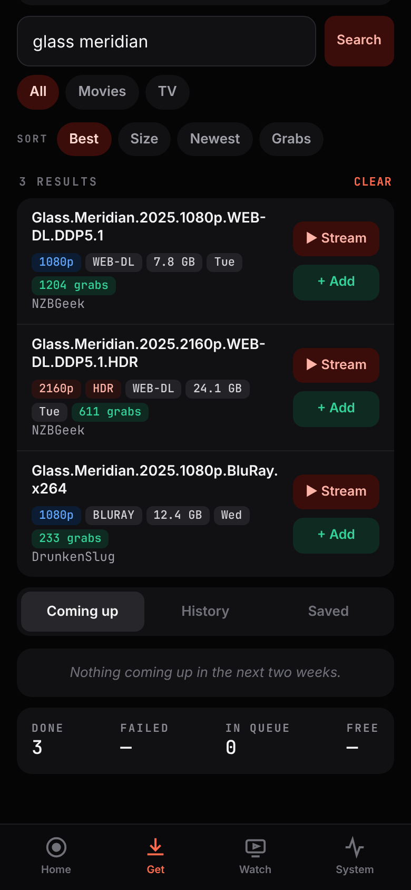
  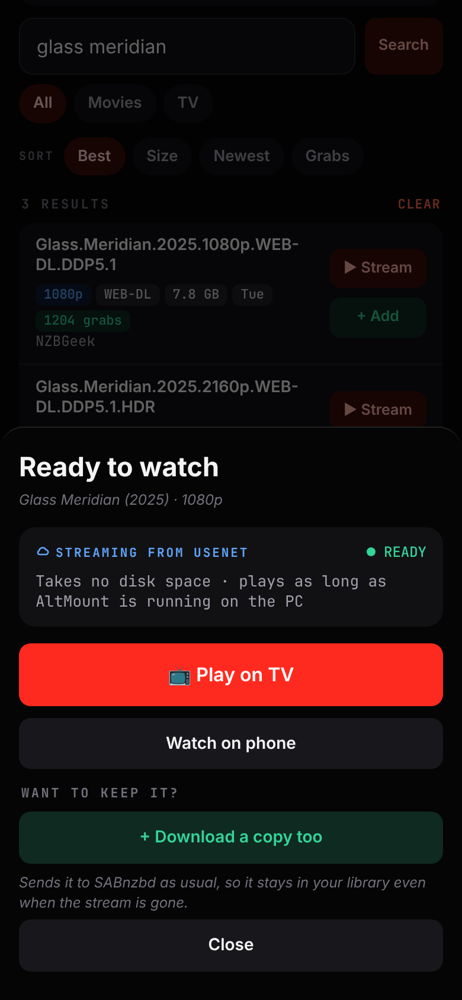
  
</p>
<p align="center"><em>▶ Stream on a search result, Ready to watch, and a Usenet stream on the TV (more in
<a href="docs/app-screenshots/README.md">the screenshots</a>)</em></p>

Nothing goes to a cloud service of its own: the phone talks to the PC over your Wi-Fi (or Tailscale when you're
out), behind an access code.

## How it started: the NZB Command Center

It all began with one Windows desktop app, the **NZB Command Center**: a single window to search Usenet indexers,
pick the best release and send it to SABnzbd, then watch it download. It worked well, and the ideas kept coming:

1. **The desktop app grew tabs.** Local NZB files, the SABnzbd queue and history, a Media Inspector for the library,
   Kodi, and Jellyfin/Plex.
2. **A phone version** (the "mobile NZB command center") let you search and add from the sofa. It soon had
   Home, Kodi, posters, TV shows, a remote, alerts and saved searches.
3. **The System Command Center** came next: a second desktop app, this time for the PC itself (CPU, GPU, drives,
   Windows, processes).
4. **HAL 9000** brought the phone side together: one calm voice that watches over the PC, the network, Pi-hole,
   Uptime Kuma and the UPS, and tells you about your evening in a sentence.
5. **The TV got a home screen of our own.** We threw out the TV's stock home screen, with its ads and promos,
   and replaced it with our own build of the open-source CleanYourTV launcher. Then we kept going: Kodi's
   recently watched shelf, the peso rate, the weather, and finally HAL himself on the TV, with his voice in the
   living room.
6. **Then we stopped waiting for downloads.** Usenet can be streamed: a player only needs the pieces of a release
   it's about to show, fetched as it plays. We tried it with AltMount on the PC (a 1984 concert film played
   first time, straight from the provider), then built it into the phone app: **▶ Stream**, then **Play on TV**.

The desktop apps are still here, still work, and still share their settings with everything else. The
phone app's **Settings › Connections** edits the same SABnzbd and indexer settings the NZB Command Center uses.
What follows is the whole thing, from the newest screen back to where it started.

## Taking over the TV

The TV is a Sony BRAVIA running Android TV. Its own home screen was rows of ads, promoted shows and apps nobody
asked for, so we replaced it completely. We started from **CleanYourTV**, an open-source TV launcher (MIT
licence), and turned it into our own: the **NZB-CC TV Launcher** in `tv-launcher/`. Then we built a whole TV
experience on top of it, piece by piece, checking each change on the real TV.

### The launcher: installed and kept up to date from the PC

- **No USB stick, no app store.** `install-on-tv.ps1` needs nothing on the TV first. It talks to the TV over
  the network (ADB), installs our signed launcher, makes it the home screen, and pushes its settings: wallpaper off,
  the glass dock, the Kodi row, the apps on Home.
- **Updates by themselves.** **Update everything**, on the PC or from the phone, checks whether the TV has the
  newest version and installs it.
  - It keeps your settings and screensaver choice.
  - It never interrupts what you're watching: if a movie, YouTube or anything else is on screen, it waits for
    next time.
  - When it's run from the phone, the TV step runs in your Windows session, so it uses the key the TV already
    trusts.
- **TV clean-up tools**:
  - `switch-off-tv-junk.ps1` switches off the leftover tracking and promo apps. It lists them first, asks, and
    `-Undo` puts them back.
  - `remove-tv-apps.ps1` removes the apps you tick in a checklist.
  - `list-tv-apps.ps1` is a read-only look at what's installed, the sound output, and HDMI-CEC.
  - `do-everything.ps1` runs all the pending steps in one go.

### A home screen of our own

- **One clean line at the top**:
  - the time, the date and the **dollar-to-peso rate**, with the day's change ("US$1 = 18.42 MXN ▲ 0.06"); it's
    live from AllRatesToday with a key, otherwise the European Central Bank's daily rate;
  - the **weather**, from Open-Meteo, with no account;
  - small round buttons for Inputs, the app library and Settings;
  - a **VPN lock** that's closed and green while NordVPN is on, and open and red when it's off.
- **Kodi's recently watched**, in the middle: five posters on a glass shelf, each with a bar showing how far in you
  are.
  - The poster you're on shows the time left, and a tick marks ones you've finished.
  - **OK** resumes it, even when Kodi wasn't running. **Holding OK** opens a menu.
  - The list comes from the PC and is saved on the TV, so it's there the moment the TV turns on. It catches up
    within seconds when you come back to Home, and includes a movie you left open in Kodi.
- **"Ready to watch"**: when SABnzbd finishes a download, a card with the poster slides in under the top line.
- **A calm dock**: one glass band along the bottom with just the apps we use, each as its own icon: Netflix, Prime
  Video, YouTube, Kodi, and **HAL 9000**. Everything else is behind the library button, and the dock keeps the order
  you set.
- **The look**: the Sora font, and a time-of-day sky in place of a wallpaper (night blues, a warm sunset glow).
  There's a news ticker too (with Mexico News Daily), off by default because it was too busy.

### The screensaver

- **Your photos**, from a folder on the PC.
- A slow zoom and a cross-fade between them, with the clock, date and weather in the corner.
- Tall photos are shown whole over a blurred fill, and sideways photos are turned upright.
- No file names or dates over the pictures.

### HAL 9000 on the TV

- **The HAL tile** in the dock, or **Show HAL on the TV** from the phone, brings up HAL's screen over whatever is on.
- **The screen**:
  - his eye in the middle, with his line and the first alert under it;
  - live boxes for **the PC**, **the network**, **Uptime Kuma** and **the Raspberry Pi**;
  - what's downloading along the bottom.
- **Five details pages** on the remote: Down opens them, Left and Right move between the PC, the network,
  Uptime Kuma, the Pi and the downloads, and Back returns.
- **His voice**: a low, slow man's voice, tuned from the PC. The eye flares on every word, and OK makes him talk
  again. From the phone you can make him say anything, and keep your own phrases.
- **Looked after**: the screen drifts a little so nothing burns in. If the PC can't be reached, the boxes dim and
  say when they were last seen, instead of showing old numbers as live.

### Run from the phone and by voice

- **The TV's own volume and mute**, in any app, from the Watch tab or "Hey Siri, ask HAL, turn it up".
- **Turn the TV on and open Kodi**, and **play anything by name**: "Hey Siri, ask HAL, play Glass Meridian" turns
  the TV on if needed and resumes where you stopped. "Hey Siri, ask HAL, turn the TV off" (or the TV off quick button on Home) puts it back in standby.
- **HAL knows what's on**:
  - the movie in Kodi;
  - the video on YouTube, or the show on Netflix or Prime;
  - the PlayStation or Switch through the Denon amp.

  Home on the phone says it in a line ("You're watching How It's Made on YouTube.").

### Things we tried

- A **Continue watching** button for Netflix and Prime Video: a separate little app beside the launcher, which you
  can install or remove with one script.
- A "cinema" preview that came before it.

All of it was built here, a step at a time, with a lot of photos of the TV in the living room along the way.

## Everything HAL does, without getting up off the couch

**Find and download**
- Search every Usenet indexer at once. Each result shows quality, HDR, source, size, age and grabs, and HAL marks
  the ones you already have.
- **Stream instead of downloading**: ▶ Stream on any result plays it on the TV straight from Usenet, through
  AltMount. Labels show what's streaming (blue, Usenet) and what's on the PC (grey). Keep a copy with one more tap.
- Add with one tap. Watch the queue: pause, resume or remove any download, or pause them all, and see the time
  left and when it'll be done.
- See what Sonarr and Radarr will fetch next. Find missing episodes from the library and send them off.
- Saved searches run by themselves every few hours and tell your phone when something new turns up.
- See the history, and retry a download that failed.

**Watch**
- Play anything in your Kodi library on the TV. Continue watching resumes where you stopped.
- Use the remote: play, pause, skip back and forward, stop, next. Control the TV's own volume and mute in any app.
- Turn the TV on and open Kodi from the phone.
- Watch movies and shows **on the phone** at home (through Jellyfin), with quality, subtitle and audio choices,
  then move what you're watching onto the TV.
- Know what's on the TV: the movie in Kodi, the video on YouTube, Netflix or Prime, or the PlayStation or Switch
  (through the Denon amp).
- Or just say it: "Hey Siri, ask HAL, play Glass Meridian", "open Netflix", or "play cat videos on YouTube".

**HAL on the TV**
- Put HAL's screen on the TV over whatever is on, and make him say anything (with your own saved phrases).
- A page each on the PC, the network, Uptime Kuma, the Raspberry Pi and the downloads, from the remote.

**Look after the PC**
- Live CPU, memory, graphics card and temperatures, with the last hour, day or week as graphs.
- Drives: how full each one is, their health, temperature, wear, and how many days until one fills up.
- Restart a service that stopped (or let HAL do it himself). Lock, sleep, fix the network, or restart (hold the
  button: "I'm afraid I can't do that, Dave.").
- Empty the Recycle Bin, clean temp files, run a Defender scan, check for Windows updates.
- See which Windows events are worth knowing about, explained in plain words, with repeats grouped.
- The UPS: battery, load, power cuts, and a safe shutdown when the battery runs low.

**Look after the network**
- Internet speed and ping, with an hour's graph.
- An alert when a new device joins your Wi-Fi ("It's mine" to dismiss it).
- Pi-hole: ads blocked today, pause blocking for 5, 30 or 60 minutes, the most blocked sites, the Raspberry Pi's
  health.
- Uptime Kuma: every monitor and its response time, and certificates about to expire.

**HAL himself**
- One line about your evening, in HAL's voice if you like.
- Phone alerts when something needs you and when it's fine again; hide an alert for a day.
- A morning briefing and a weekly summary.
- **Voice control through Siri**: "Hey Siri, ask HAL, play Glass Meridian" starts it on the TV (turning the TV on
  if it's off), "play Night Harbor" plays the next episode, plus pause, resume, stop, skip, turn it up or down,
  mute, "what's on?" and "what's new?". The status, the ads, lock and sleep, the drives and the briefings work by
  voice too ([how to set it up](docs/siri-and-widget.md)).
- A home-screen widget, a wall display for a spare tablet, chess, a song.
- HAL's record (ads blocked, data downloaded, days on duty) with milestones.

**Keep it all up to date**
- **Update everything** from the phone: the apps on the PC and the TV app, without stopping a movie that's playing.
- Edit SABnzbd, the indexers, Kodi, Pi-hole and Uptime Kuma from the phone. Settings backups go to GitHub with the
  keys removed.

## HAL 9000 on the phone

The app is one page (`/app`), added to the phone's home screen like an app. HAL's eye sits at the top, with one line
about your evening.

- **Home**:
  - what needs you (alerts you can hide for a day);
  - internet speed with an hour's graph;
  - Pi-hole and Uptime Kuma;
  - rings for CPU, memory, GPU and temperature;
  - drives, the last restart, and what's on the TV: the movie in Kodi, the video on YouTube, Netflix or Prime, or
    the games console;
  - quick buttons.
- **Get**: the download queue at the top, search across your indexers (with quality, size, age and grab badges),
  what Sonarr and Radarr will fetch next, the history, and saved searches that tell your phone when something new
  turns up.
- **Watch**: the TV (play, pause, volume, mute), HAL on the TV, continue watching, and your Kodi library. Movies and
  shows also play **on the phone** at home, through Jellyfin.
- **System**: every system at a glance, with HAL's own pages for vitals, services, drives, network, security,
  power and the log. There's also HAL's record, chess against HAL, a wall display for a spare tablet, and a song.

Every screen is in [docs/app-screenshots](docs/app-screenshots/README.md). HAL also answers Siri and has a
home-screen widget ([docs/siri-and-widget.md](docs/siri-and-widget.md)).

## HAL on the TV

(The whole TV story, home screen and all, is in [Taking over the TV](#taking-over-the-tv) above. Here are HAL's screens in pictures.)

| The TV's home screen | With HAL selected in the dock |
|---|---|
| 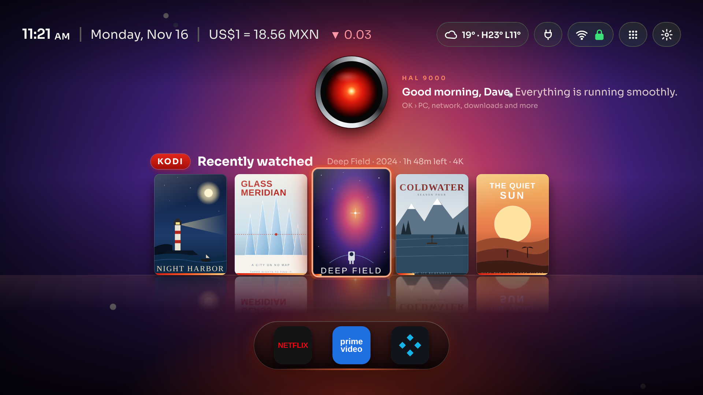 | 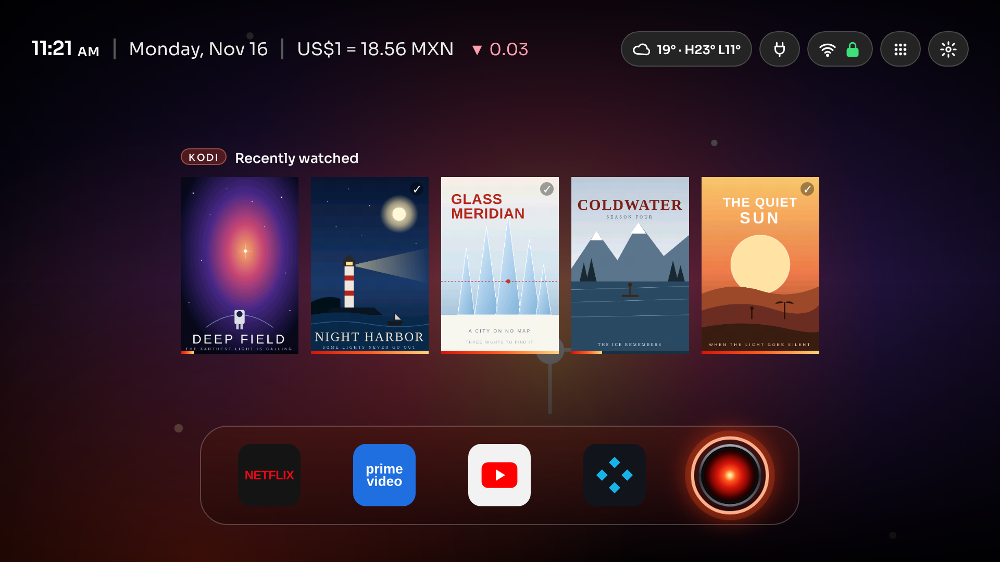 |

### HAL's screen

Open the HAL tile, or tap **Show HAL on the TV** in the phone app's Watch tab, and HAL's screen comes up over
whatever is on:

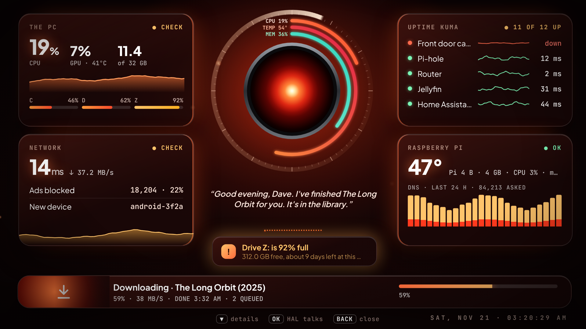

- **HAL's eye** in the middle, with his line under it. The eye gets an amber or red ring when something needs you,
  and the first alert shows under his line, with how many more there are.
- **Four boxes**:
  - **The PC**: CPU, graphics card, memory, how full each drive is, power and the UPS.
  - **Network**: internet speed and ping, the router, ads blocked, Tailscale, security.
  - **Uptime Kuma**: monitors that are down come first.
  - **Raspberry Pi**: its temperature, load and memory, and Pi-hole's version.
- **Along the bottom**: what SABnzbd is downloading, with a progress bar and when it'll be done.
- **HAL talks**: he says his line when the screen opens, in a low, slow voice (tunable from the PC), and the eye
  flares on every word. **OK** on the remote makes him talk again. From the phone you can make him say anything
  (**Talk on the TV…**, with your own saved phrases).
- **Details pages**: press **Down** for a full page each on the PC, the network, Uptime Kuma, the Raspberry Pi and
  the **downloads** (the queue with progress bars, today's finished and failed downloads, what's coming up, and
  saved searches). **Left** and **Right** move between them, and **Back** returns to HAL. They refresh every 15
  seconds.
- **When the PC is off**: the boxes dim and say when they were last seen, so old numbers never pass for live ones.

| The PC | Network |
|---|---|
| 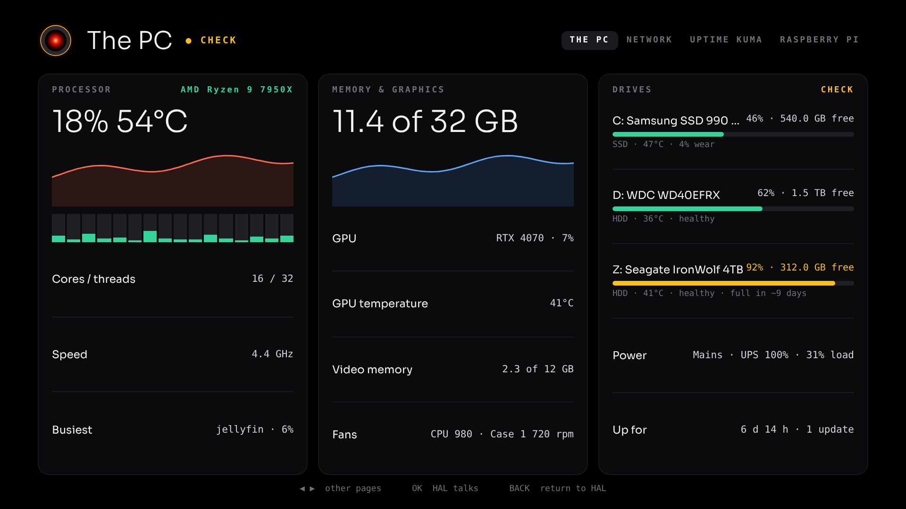 | 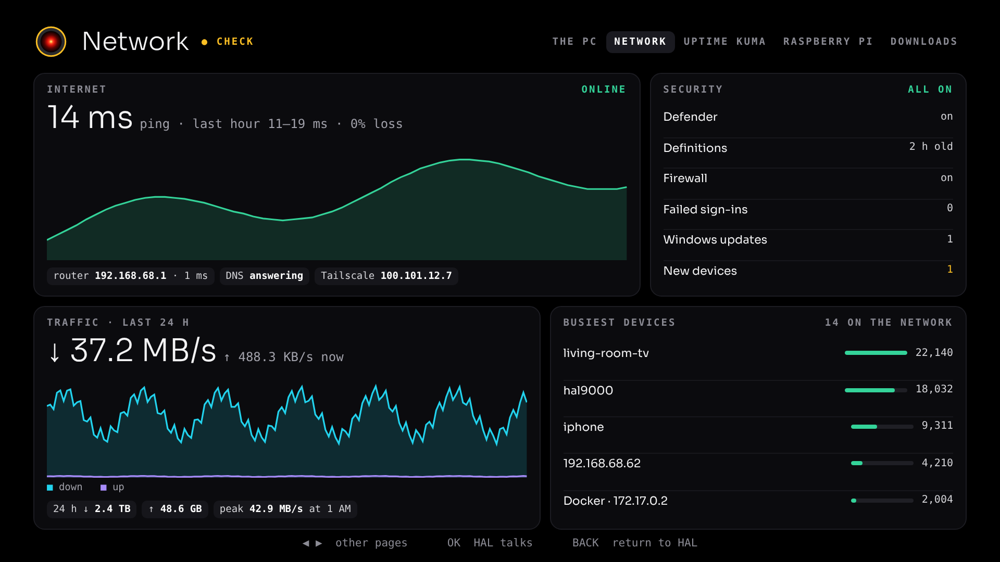 |
| **Uptime Kuma** | **Raspberry Pi** |
| 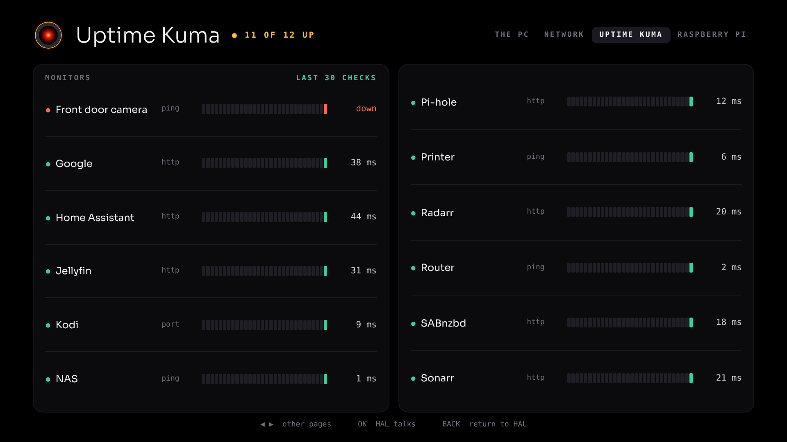 | 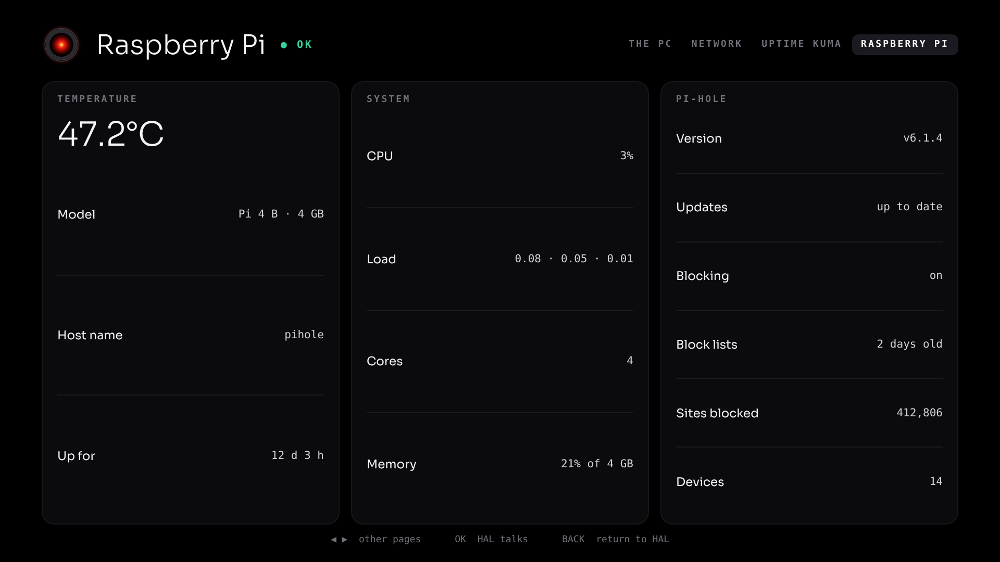 |
| **Downloads** | **When the PC can't be reached** |
| 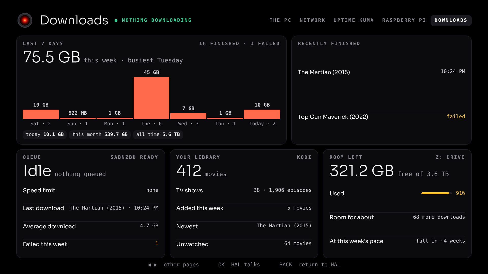 | 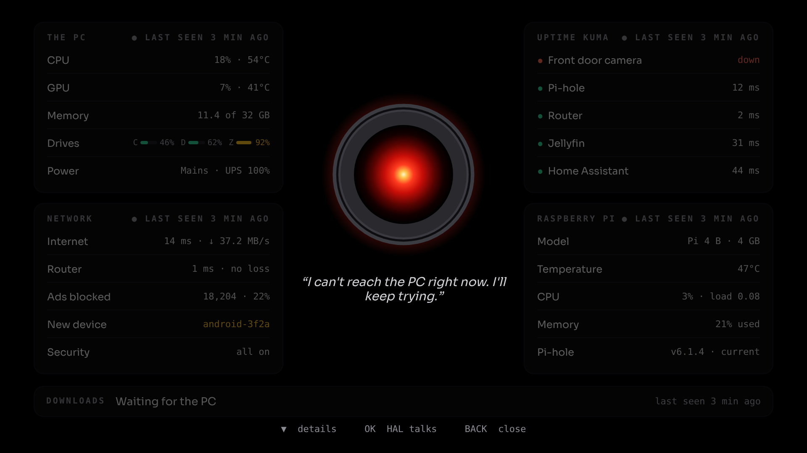 |

The screen drifts a little every few minutes so nothing burns in. **Update everything** puts new versions of the
TV app on the TV by itself, and never while you're watching something. (These pictures are drawn from HAL's demo
data, so the numbers aren't real.)

## The desktop command centers (where it started)

### NZB Command Center

`nzb_command_center.py`: the original. One window, with a live header (download speed, totals, drive space,
today's NZBs, the active download and a bandwidth graph) and seven tabs:

- **Indexer Search**: searches every indexer at once and scores each release.
  - A ★ Best pick, plus badges for 4K, HDR, Dolby Vision, REMUX and codec, and a "size looks wrong" check.
  - Hides duplicates and checks against your library ("you have it").
  - Filters for quality, size and language, and auto-picks the SABnzbd category.
  - **Send to SAB**, Save, or **Grab Best**.
- **Local NZB Files**: a watch folder you can auto-send from, with an inspector for any .nzb.
- **SABnzbd Queue & History**: pause, delete, priority, reorder, a speed limit, retry failed downloads, and
  notifications when downloads finish.
- **Media Inspector**: scans your movie and TV folders (codec, HDR, audio, size, duplicates).
- **Kodi**: what's playing, play/pause/stop, the movie library, recently added, and what's on disk but missing
  from Kodi.
- **Media Server**: Jellyfin or Plex streams, library syncs, and audits for what's missing or orphaned.
- **Activity Log**.

| Indexer search | SABnzbd queue and history |
|---|---|
| 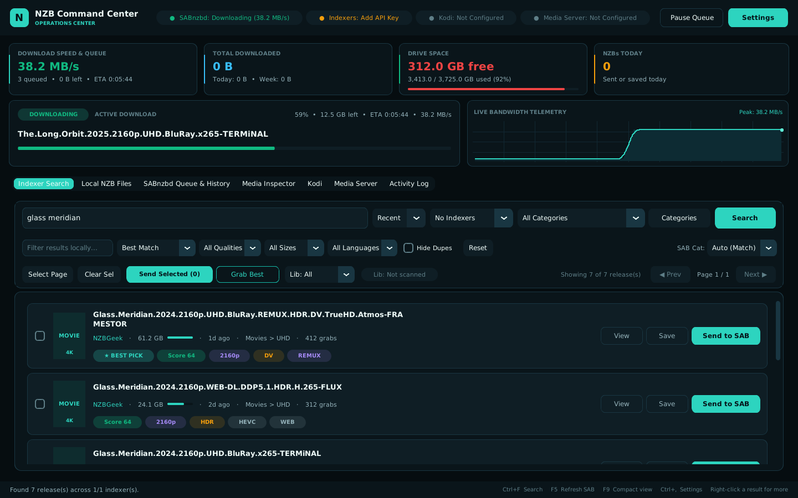 | 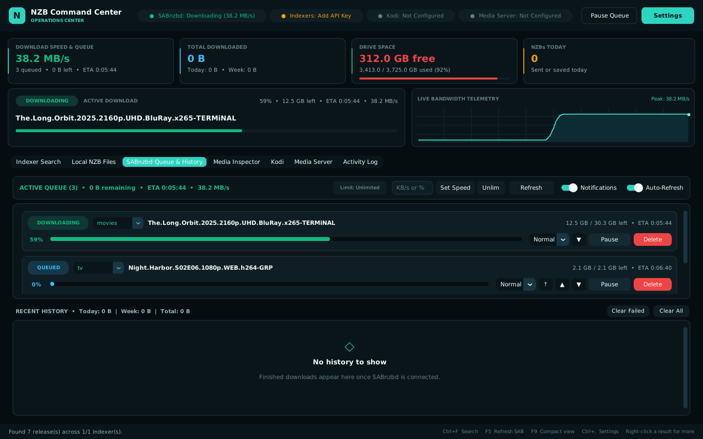 |
| **Local NZB files** | **Kodi** |
| 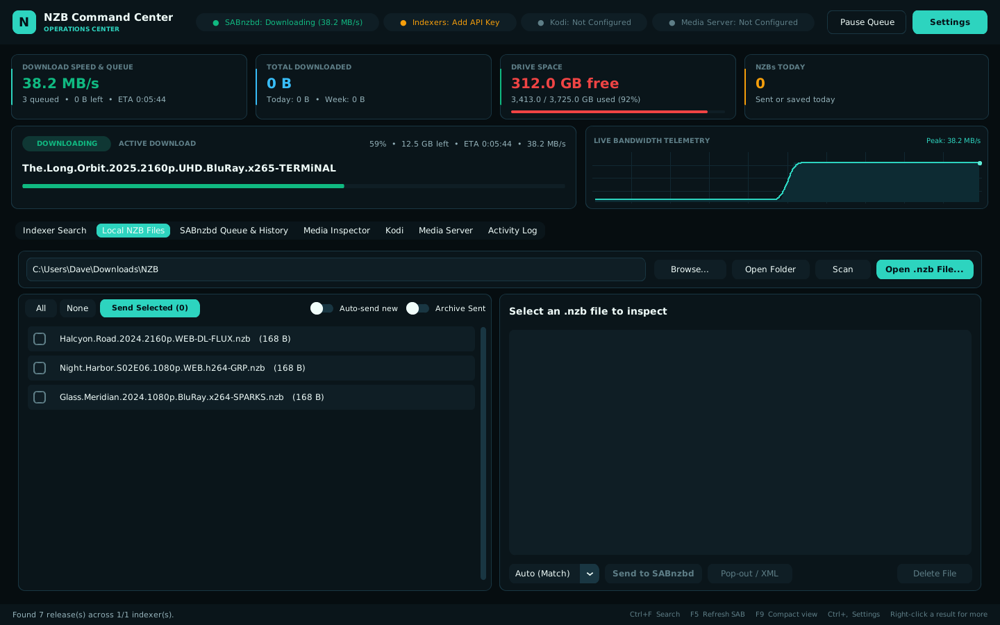 | 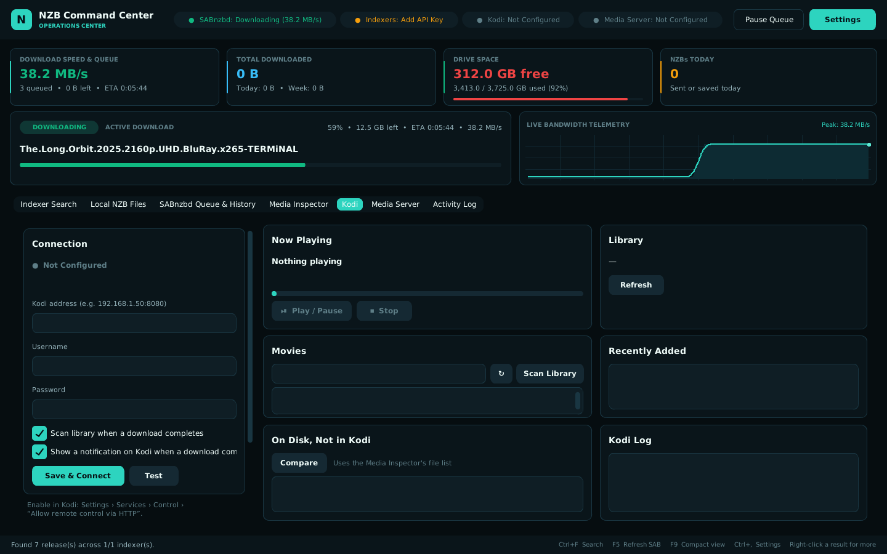 |

```powershell
pip install customtkinter pillow
python nzb_command_center.py
```

### System Command Center

`system_command_center.py`: a live dashboard for the PC itself, and the part that grew into HAL.

- **Dashboard**: CPU, memory, GPU and network gauges with graphs, drives, the system, top processes, alerts.
- **CPU & Memory**: per-core load, clock speeds, temperatures and fans, memory modules.
- **GPU**: load, video memory, temperature, power, clocks, the video engines, and which apps are using it.
- **Drives**: space, a space analyzer, health, temperatures and wear, live activity, cleanup.
- **Network**: throughput, ping and packet loss, Wi-Fi, adapters, Flush DNS.
- **Processes**: sortable and filterable, grouped by app, End task.
- **Windows**: edition and build, Defender and firewall, pending restart, Windows Update, power plans, startup
  apps.
- **Tools, Alerts, Settings**: one-click Windows tools and maintenance, thresholds and notifications.

| Dashboard | CPU & Memory |
|---|---|
| 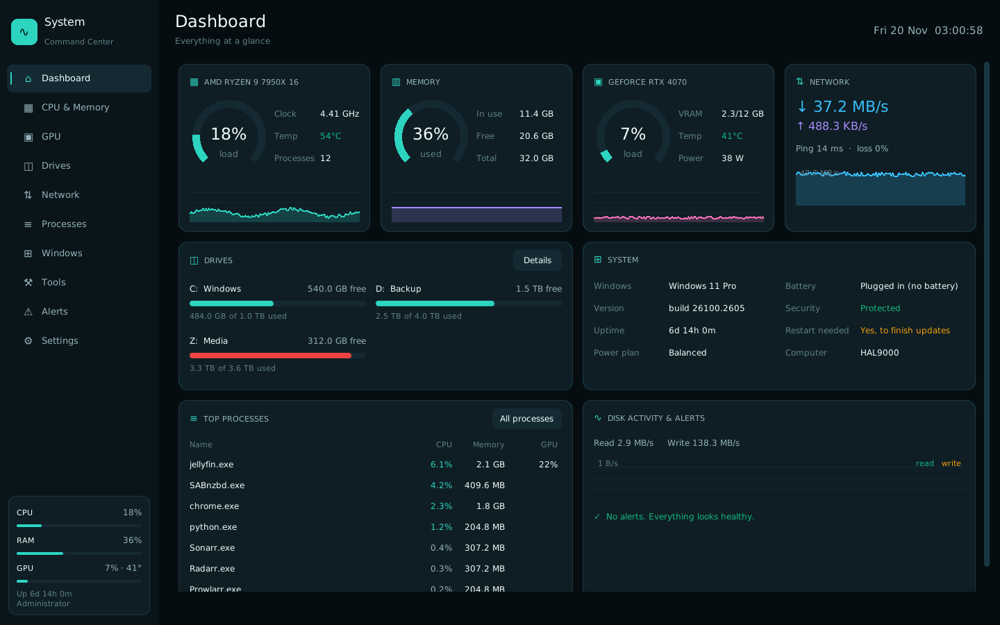 | 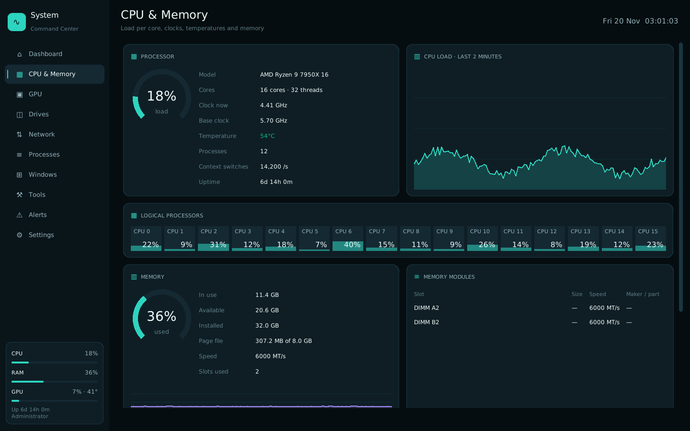 |
| **Drives** | **Windows** |
| 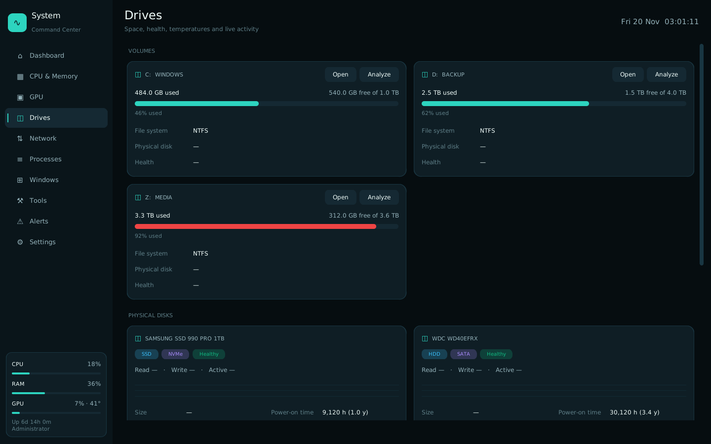 | 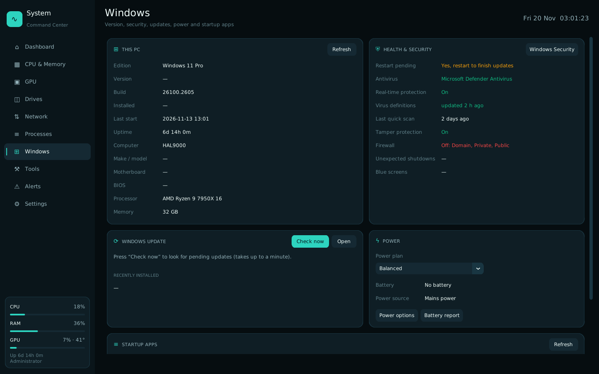 |

More: [GPU](docs/desktop-screenshots/system-3-gpu.png) · [Processes](docs/desktop-screenshots/system-6-processes.png) ·
[Tools](docs/desktop-screenshots/system-8-tools.png) · [Media Inspector](docs/desktop-screenshots/nzb-4-media-inspector.png) ·
[Media Server](docs/desktop-screenshots/nzb-6-media-server.png). (Taken with demo data.)

```powershell
pip install customtkinter psutil pillow
python system_command_center.py
```

## How it fits together

```
 phone (HAL app, /app)  ──Wi-Fi / Tailscale──▶  mobile_server.py on the PC (port 8765)
                                                  ├─ HAL 9000 (hal_server.py, /hal): watches the PC, alerts, history
                                                  ├─ SABnzbd · Sonarr · Radarr · Prowlarr · your indexers
                                                  ├─ AltMount (port 8090): streams Usenet releases to Kodi, nothing downloaded
                                                  ├─ Kodi and Jellyfin
                                                  ├─ Pi-hole · Uptime Kuma · the UPS (NUT)
                                                  └─ the TV over ADB (tv-launcher/tools): HAL's screen, volume, what's on
 Android TV  ◀── tv-launcher (NZB-CC TV Launcher APK, with HAL's screen)
 Windows desktop: nzb_command_center.py and system_command_center.py (same settings files)
```

| Part | What it is |
|---|---|
| `mobile_server.py` | The phone server: the HAL app at `/app`, the classic NZB app at `/`, and HAL at `/hal` |
| `app_page.py` | The HAL 9000 all-in-one app (one page: Home, Get, Watch, System) |
| `hal_server.py` | HAL: watches the PC, services, network, Pi-hole, Uptime Kuma, UPS; alerts, briefings, history |
| `system_monitor.py` | Reads the PC's hardware, drives, security and Windows details (HAL and the System Command Center) |
| `nzb_command_center.py` + `kodi_client.py`, `media_inspector.py`, `media_server.py` | The NZB Command Center desktop app and its tabs |
| `system_command_center.py` | The System Command Center desktop app |
| `tv-launcher/` | The Android TV launcher (with HAL's screen) and the scripts that install it |
| `setup.ps1`, `update_all.ps1`, `backup_settings.ps1` | Set up once, update everything, back up your settings |
| `try_altmount.ps1`, `setup_altmount_startup.ps1`, `play_altmount.ps1` | Install AltMount (Usenet streaming), start it with Windows, play a stream in VLC on the PC |
| `tests/` | Tests for the servers, the apps and the desktop apps (`python tests/test_hal.py` etc.) |

## Getting started

1. Install Python 3 on the Windows PC, put this folder somewhere permanent, and run **`setup.ps1`**
   (right-click › Run with PowerShell). It starts the phone server with Windows and moves HAL into it.
2. On your phone, open `http://<your-pc>:8765/app/`, pair with the 6-digit PIN from
   `http://localhost:8765/hal/pair` on the PC, and add the page to your home screen.
3. In the app: **Settings › Connections** for SABnzbd, your indexers, Kodi, Pi-hole and Uptime Kuma (keys are
   stored encrypted for your Windows user and never sent to the phone). Or set them in the NZB Command Center.
4. Optional: install the TV launcher with `tv-launcher/install-on-tv.ps1`.
5. Optional: Usenet streaming. Install AltMount with `try_altmount.ps1` (guide: `docs/altmount-streaming-test.md`),
   then follow `docs/usenet-streaming-setup.md` to switch on the Stream buttons and Play on TV.

**Updating**: **Update everything** in the app (Settings), or `update_all.ps1`. It downloads the newest files from
GitHub, checks them, restarts what's needed and updates the TV app, without stopping a movie that's playing.
**Backups**: `backup_settings.ps1` backs your settings up to GitHub with every key and password removed.

## Privacy and security

- Every request needs the access code; wrong codes are rate-limited. The server only answers your home network
  and Tailscale unless you allow more.
- API keys and passwords are encrypted with Windows DPAPI in the settings files, and never shown again.
- Nothing is sent anywhere else, apart from what you set up yourself (ntfy alerts, your indexers, the weather on
  the TV).

## Credits

- The TV launcher is built on [CleanYourTV](tv-launcher/LICENSE-cleanyourtv) (MIT) and uses the Sora font (OFL).
- HAL 9000 and *2001: A Space Odyssey* belong to their owners; this is a fan tribute for a home setup, not affiliated.

---

# Reference

Everything below goes into each part in detail: setup steps, settings and how things work.

### Phone app home-screen icons

Open the phone app's address in your phone's browser and add it to your home screen
(iPhone: Safari > Share > **Add to Home Screen**; Android: Chrome > ⋮ > **Add to Home screen** / **Install app**):

- `http://<your-pc>:<port>/` gives the **NZB Center** icon (downloads, search, queue).
- `http://<your-pc>:<port>/kodi` gives a separate **Kodi** icon (a TV with a play button) that opens straight on the Kodi tab.
  Pair once in either; the other uses the same pairing code. On Android you can also long-press the NZB Center icon and pick **Kodi**.

### System Command Center (Windows desktop)

A live dashboard for your PC: Windows, CPU, memory, GPU, drives, network and processes.

```powershell
pip install customtkinter psutil pillow
python system_command_center.py
```

Keep `system_monitor.py` next to it. Pages:

- **Dashboard**: CPU, memory, GPU and network gauges with 2-minute graphs, drive space, system status, top processes, alerts
- **CPU & Memory**: per-core load, real clock speed, memory modules, temperatures and fans
- **GPU**: load, VRAM, temperature, power, clocks, fan, PCIe link and engine load (3D, video decode/encode) for every card, plus which apps are using it
- **Drives**: space per volume, a space analyzer (largest folders and files), physical disk health/temperature/wear, live activity, Recycle Bin and temp-file cleanup
- **Network**: throughput, ping/packet loss, Wi-Fi signal, adapters, Flush DNS
- **Processes**: sortable and filterable list with CPU, memory, GPU and disk use; group by app; End task
- **Windows**: edition/build, Defender and firewall status, pending restart, Windows Update check, power plans, startup apps on/off, recent errors from the event log
- **Tools**: one-click Windows tools, maintenance (Restart Explorer, Defender quick scan…), lock/sleep/restart/shut down
- **Alerts / Settings**: thresholds for CPU, RAM, temperatures, VRAM, drive space and battery, with optional Windows notifications

Data sources: psutil; Windows GPU performance counters (any GPU vendor); `nvidia-smi` for NVIDIA temperature, power and clocks;
PowerShell/CIM for hardware, disk health and security status. Windows doesn't expose CPU temperatures or fan speeds by itself:
run [LibreHardwareMonitor](https://github.com/LibreHardwareMonitor/LibreHardwareMonitor) in the background and turn on its
**Options > Remote Web Server > Run** (port 8085; the app also reads its WMI feed when that's available).
Run as administrator to see drive temperatures and wear.

### Fun with HAL

- **Siri and a home-screen widget**: see [docs/siri-and-widget.md](docs/siri-and-widget.md)
  ("Hey Siri, ask HAL: pause the ads / how hot is it / what's my record...", and `extras/hal_widget.js` for Scriptable).
- **Morning briefing** (and a weekly summary on the day you pick) to your phone: HAL's settings › Briefings.
- **HAL's record** on the System tab: lifetime ads blocked, data downloaded, days watching, power cuts,
  longest uptime, with milestones ("1 million ads blocked, Dave.").
- **Chess with HAL** (System › For fun), the **wall display** (HAL's eye and live readings, full screen, for a
  spare tablet), and **Ask HAL to sing**. He also sings when you restart the PC from the app.
- Try typing "open the pod bay doors" in the search box.

### Uptime Kuma in HAL

HAL reads Uptime Kuma's monitors (its `/metrics` page). In the app: **Settings › Connections › Uptime Kuma**,
address like `192.168.68.63:3001` and an API key from Uptime Kuma › **Settings › API Keys** (stored encrypted).
Home shows a card (all up, or which are down); tap it for every monitor with its response time. HAL alerts
(and pushes) when a monitor goes down and when it's back, and when a certificate has a week or less left.

### Home screen (phone)

Alerts · quick buttons (Lock PC, Sleep, TV on, pause ads 5 min) · UPS card during a power cut · CPU/RAM/GPU/ping ·
internet (online, down/up now, ping, loss) · drives · Pi-hole · Uptime Kuma · last restart (Restart when Windows
is waiting) · what's on the TV · every system. Downloads are on **Get**.
New devices: Pi-hole sees every device on the network; HAL alerts (and pushes) when one it hasn't seen before
shows up (**It's mine** clears it). The first check just learns what's already there.

### Pi-hole in HAL

HAL watches the Pi-hole (Pi-hole 6 or 5, worked out on its own) and, on Pi-hole 6, the Raspberry Pi itself:
model, temperature, CPU, memory, uptime and whether a Pi-hole update is available (alerts at 75°C and 92% memory). With no address set it looks for it
among the PC's DNS servers. **System › Pi-hole** in the app shows what was blocked today, the most
blocked sites and the busiest devices, with **Pause 5 min / 30 min / 1 hour** (it turns itself back on)
and **Turn back on**. HAL alerts when the Pi-hole stops answering (websites stop loading everywhere),
when blocking is left off, or when the block lists are over two weeks old.

Address and password: **Settings › Connections › Pi-hole** (the password you sign in to Pi-hole with,
or a Pi-hole 6 app password; on Pi-hole 5 the API token). It's stored encrypted in `hal_settings.json`.

### Watch on the phone (home Wi-Fi only)

In the app, **Watch › Your library**: tap a movie (or an episode) for its page, then **Watch on phone**.
The phone server finds the same film in Jellyfin (same file name, else title and year) and relays
Jellyfin's stream, so the phone never sees Jellyfin's key and Safari plays it natively (full screen, AirPlay).

- **Best** plays the file as it is (no converting); **1080p** / **720p** convert it, if Best stutters.
  Subtitles and sound tracks are under **...**.
- Where you stop is remembered (`watch_positions.json`) and handed to Kodi, so **Move to TV** (or
  Play on TV later) carries on from the same spot. Finishing it marks it watched in Kodi.
- It only works on the home network: away from home (mobile data or Tailscale) the button is off.
- Uses the Jellyfin connection the phone server already has (desktop app's Jellyfin settings, or
  Connect in the classic phone app's Jellyfin tab).

### Scripts: one setup, one update, one backup

Right-click > Run with PowerShell, from your NZB Command Center folder:

- **setup.ps1** - everything you set up once. It shows what is already set up on this PC (phone server
  at startup, HAL inside the phone server, Jellyfin at startup, automatic sign-in then lock,
  Sonarr/Radarr/Prowlarr) and runs the step you pick; **U** undoes Jellyfin or automatic sign-in.
  The steps are still the separate `setup_*.ps1` / `install_arr_resume.ps1` scripts, so the
  instructions below still work.
- **update_all.ps1** - updates everything (same as **Update everything** in the app).
  `update_phone_app.ps1` now just runs it.
- **backup_settings.ps1** - backs up your settings to GitHub.

### HAL 9000 all-in-one app (/app)

One app for everything, on the phone and the PC: open `http://<your-pc>:8765/app/` and add it to the home screen
(on the PC: Edge/Chrome > Install this site as an app). It opens already signed in if the NZB app is paired on that
device; otherwise type the 6-digit PIN from `http://localhost:8765/hal/pair`.

- **Home**: HAL's eye and one line about your evening (downloads, the TV, anything that needs you), what needs
  attention, what's downloading (pause/resume, ready time), what's on the TV (pause), Jellyfin streams, what just
  arrived (Play on TV), what's coming up, today's totals.
- **Get**: search your indexers (Add, "have it"), the queue (pause, resume, remove), coming up from Sonarr/Radarr.
- **Watch**: the TV remote (Kodi), continue watching (Play on TV), Jellyfin streams, TV on + Kodi.
- **System**: HAL's vitals, alerts and systems; each opens HAL's full page (with an App button to come back).
- HAL talks on the phone (after your first tap; the speaker button mutes him), not on the PC. On a wide screen it
  shows a sidebar and three columns.

The classic NZB app (`/`, `/kodi`) and HAL (`/hal/`, port 8766) keep working alongside it. **Settings › Connections**
edits SABnzbd, your indexers (add, edit, switch off, remove) and Kodi, with a Test button for each. It writes the desktop
app's own `nzb_manager_config.json` (keys encrypted for your Windows user, never sent to the phone; a copy of the
previous file is kept as `nzb_manager_config.json.bak`), so the desktop app isn't needed for them any more. Close the
desktop window before saving there: its next save would put the old settings back (the page warns when it's open).
The page is `app_page.py`.

### HAL 9000 (phone app that watches over this PC)

> "I am putting myself to the fullest possible use, which is all I think that any conscious entity can ever hope to do."

`hal_server.py` is a second phone app, just for keeping an eye on the PC (HAL9000) and everything running on it.
From phone app 3.12 it runs **inside the NZB phone server** (one program, one startup task, one log: `mobile_server.log`):
open `http://<your-pc>:8765/hal/` on the phone, or HAL's own port 8766 as before (your HAL icon keeps working).
`update_all.ps1` (or `setup_hal_startup.ps1`) moves an existing HAL over and removes the separate "HAL 9000 Server" task.
Pair at `http://localhost:8765/hal/pair` on the PC. `python mobile_server.py --no-hal` runs the phone app without HAL.
It needs `psutil` and `system_monitor.py` (the System Command Center's monitor) in the same folder.

```powershell
pip install psutil
python hal_server.py            # then open http://<your-pc>:8766/ on your phone
```

Or right-click **setup_hal_startup.ps1** > Run with PowerShell: it installs psutil, starts HAL as administrator
whenever you log in (restarting it if it ever stops), opens port 8766 on private networks and prints the address.
Pair with the **same access code as the NZB phone app**, then add it to your home screen (it gets its own red-eye icon).

- **Status**: HAL's eye glows steadily when all is well, gets an amber ring when something needs a look and pulses when
  something is critical. HAL tells you what's wrong in his own words. Live CPU / memory / GPU / internet, and six
  critical systems (media services, network, storage, hardware, security, power).
  When HAL has something new to say, the words type out and his light flickers as he "speaks";
  he also **talks out loud**: after your first tap (phones only allow sound after a touch) he greets you, speaks
  whenever something changes and answers when you press a button. The speaker button turns that off; Settings >
  HAL's voice picks the voice, speed and pitch (on an iPhone, download an Enhanced voice such as Daniel for the best one).
- **Vitals**: CPU, memory and GPU with live / 1 h / 24 h / 7 d graphs, per-core load, temperatures and fans
  (LibreHardwareMonitor, as for the System Command Center), busiest apps.
- **Services**: SABnzbd, Jellyfin, Sonarr, Radarr, Prowlarr and the NZB phone server: answering, response time and
  what each is doing. **Restart / Start** from the phone (through its Task Scheduler task, its Windows service, or
  the command line it was last running with). Optional: HAL restarts a service by himself when it stops answering
  (at most 3 times a day). Also the router, Kodi on the TV, your indexers and Tailscale.
- **Drives**: free space with "about N days left" at this week's rate, health, temperature, wear, errors, hours,
  live activity; empty the Recycle Bin and clean temp files.
- **Shield**: the **UPS** (charge, runtime, load in % and watts, input/output voltage, the last hour, power cuts),
  Defender, firewall, Windows Update, pending restart, failed sign-ins, crashes and unexpected shutdowns, disk errors
  in the event log, internet / DNS / throughput.
- **Windows events** (Shield > Windows errors & events): only what you'd need to see from the event logs, in plain
  English with the drive letter: drive errors and retries, crashes and power losses, blue screens, hardware (WHEA)
  errors, services and apps that crashed, failed updates, Defender alerts. 24 h / 7 days / 30 days, by category; tap one
  for what it means and the original message. Drive errors this week also raise an alert.
- **Log & controls** (the bell): everything HAL noticed, and the pod bay controls: Lock, Sleep, Fix network (flush
  DNS, renew the address), Test alert, and *hold for 2 seconds* to restart or shut down the PC (60 seconds to cancel).
- **Phone alerts** through ntfy: the NZB phone app's topic is used automatically (or set HAL's own in Settings).

**UPS**: a UPS plugged in by USB shows up in Windows as a battery and HAL reads it automatically. A UPS watched by
Network UPS Tools (WinNUT, a NAS, a Raspberry Pi) works too: put its address in Settings > UPS. Turn on
**Shut the PC down safely on low battery** and HAL shuts Windows down cleanly at the battery % or minutes left you
choose, and cancels it if the power comes back in time.

`python hal_server.py --demo` shows the app with made-up data (`--demo-ups battery` for a power cut), on any PC.
HAL's own files: `hal_settings.json`, `hal_state.json` (history and log), `hal_server.log`.

### Update from the phone

The app's **System › Update everything** (and HAL's **Log & controls › Update**) runs `update_all.ps1 -Unattended` on
the PC as its own Windows task: it downloads the newest files, restarts the phone server, and the app reloads with
the new version once HAL reports back ("Updated to version 3.14.0", "Already up to date", or what went wrong; also in
HAL's log). Open desktop apps aren't closed: they use the new version next time you open them. The run is logged in
`update_all.log`, the outcome in `update_result.json`.

### Start everything when the PC turns on (no login needed)

Right-click **setup_autologon.ps1** > Run with PowerShell. It downloads Microsoft's free Sysinternals **Autologon**
(checked to be signed by Microsoft), opens its window so you can type your Windows password there (a Microsoft
account's password, not the PIN; the script never sees it), and adds the task "Lock screen after automatic login".
After that, when the PC turns on or restarts, Windows logs you in by itself, SABnzbd, Sonarr, Radarr, Prowlarr,
Jellyfin, the phone server and HAL all start as usual, and the screen locks 8 seconds later (your PIN is still
needed to use the PC). Undo: run it with `-Undo`.

### Phone server files

`mobile_server.py` keeps its web page in `mobile_page.py`, its icons in `mobile_icons.py` and the all-in-one app in
`app_page.py`: keep them all in the
same folder (`update_all.ps1` and `update_phone_app.ps1` fetch them together). If one is missing the server still
starts, shows a page saying which file to get back, and logs it.

### TV home row (phone server)

`mobile_server.py` also serves the newest movies to a TV home screen, so a launcher can show them with their
posters and start one in Kodi in one press, even when Kodi wasn't running:

- `GET /api/tv/recent`: the newest 12 movies (Kodi's recently added, plus finished SABnzbd movie downloads Kodi
  hasn't scanned yet), newest first, each with a poster URL. Kodi's part is remembered for when Kodi is off.
- `GET /api/tv/poster?id=…`: the saved poster (kept in `tv_art/` next to the server).
- `POST /api/tv/play` `{"id": "…"}`: waits up to 45 s for Kodi (the TV starts it first), then plays the movie.

Like every `/api/` call they need the access code in the `X-Mobile-Token` header. The server learns how Kodi
reaches this PC's folders (for example `D:\Movies` = `smb://HAL9000/Movies`) from downloads Kodi already has,
so a new download can be played before Kodi has scanned it.
